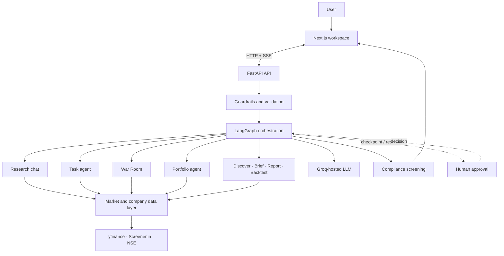

FinIntel
Your AI-powered equity research desk for Indian markets.
Research with specialist agents. Stay in control with human approval. Trust the output with compliance-first guardrails.

  
  
  
  
  

Overview · Capabilities · Architecture · Run locally · API · Status

Important: FinIntel is an educational/research software project, not a broker, trading system, or source of investment advice. Generated analysis must be independently verified. The repository's design documents describe the intended product and architecture; not every listed capability is currently implemented.

✦ The idea
Equity research is fragmented. Investors often jump between market data, financial statements, news, screeners, portfolio spreadsheets, and backtesting tools before they can make sense of a stock.

FinIntel brings that research workflow into one workspace. Specialised agents support research, risk analysis, portfolio review, and market discovery. The user remains in control: agent workflows can pause for approval, and generated responses are designed to pass through a compliance pipeline.
Design principles
Principle	What it means
Human in control	Agent workflows pause at approval gates. Users can approve, reject, stop, or redirect.
Grounded analysis	Market metrics are calculated in Python; the LLM interprets and explains results.
Transparent data	Live data and offline sample data are explicitly distinguished.
Safer outputs	Input validation, prompt-injection checks, output screening, PII scrubbing, and disclaimers.
Observable workflows	Agent progress is streamed to the client using Server-Sent Events (SSE).

◈ What you can do
The product design defines these research workspaces:
<table>
  <tr>
    <td width="50%">
      <h3>◉ Analyst</h3>
      Give an agent a stock and a research task. Review its proposed steps and decide whether it can continue.
    </td>
    <td width="50%">
      <h3>⌘ Research Chat</h3>
      Ask ticker-specific questions. A ReAct agent can use research tools, review its draft, and screen its response.
    </td>
  </tr>
  <tr>
    <td>
      <h3>◷ Market Brief</h3>
      Bring watchlist signals and broader market cues into a concise briefing.
    </td>
    <td>
      <h3>⌕ Discover</h3>
      Translate a natural-language stock-screening request into validated filters and a universe scan.
    </td>
  </tr>
  <tr>
    <td>
      <h3>▤ Portfolio</h3>
      Review holdings, concentration, risk, and stress scenarios; inspect proposed rebalance actions before approval.
    </td>
    <td>
      <h3>⚖ War Room</h3>
      Coordinate specialist analysis, Bull/Bear arguments, and a judge that produces a reasoned verdict for user review.
    </td>
  </tr>
  <tr>
    <td>
      <h3>⌘ Ecosystem</h3>
      Explore relationships between a company, its competitors, customers, suppliers, and partners.
    </td>
    <td>
      <h3>▧ Reports & Backtests</h3>
      Combine research engines into a report and compare historical strategies using calculated performance metrics.
    </td>
  </tr>
</table>⌘ How it works
System architecture

The approval loop
1. The client starts a workflow with a unique thread UUID.
2. LangGraph executes the workflow and streams progress events to the browser.
3. At a decision point, the graph calls interrupt() and checkpoints its state.
4. The user approves, rejects, stops, or provides revision instructions.
5. The client resumes the same graph using the same thread UUID.
6. The workflow continues and streams its result.
Separation of responsibilities
- Python computes: volatility, Sharpe ratio, beta, RSI, moving averages, drawdown, stress impacts, CAGR, and XIRR.
- The LLM interprets: it explains calculated values, compares evidence, and produces readable research narratives.
- The compliance layer checks: model output is screened before it is returned to the user.
- The UI communicates: stream status, approval requests, disclaimers, and whether the underlying data is live or sample data.
⚙ Technology
Layer	Technologies
Frontend	Next.js App Router, React, TypeScript
UI	Tailwind CSS, shadcn/ui
Backend API	Python 3.11+, FastAPI, Uvicorn
Agent orchestration	LangGraph, LangChain
Model provider	Groq
Market data	yfinance, Screener.in, NSE (best-effort sources)
Persistence	Supabase (optional; local development fallback described in the backend spec)
Streaming	Server-Sent Events (SSE)

▣ Repository layout
.
├── client/
│   ├── app/                 # Next.js App Router
│   ├── components/
│   │   ├── agents/          # Individual research workspaces
│   │   ├── shared/          # Shared UI and stream components
│   │   └── ui/              # UI primitives
│   └── lib/                 # API, auth, and SSE utilities
├── server/
│   └── main.py              # Current backend entry-point placeholder
├── docs/
│   ├── backend-design.md    # Backend architecture and API contract
│   └── frontend-design.md   # Pages, routes, and client behaviour
├── AGENTS.md                # Repository-level engineering guidance
├── CLAUDE.md                # AI coding-agent guidance
└── README.md
For the detailed implementation contracts, see:
- [Backend design specification](docs/backend-design.md)
- [Frontend design specification](docs/frontend-design.md)
🚀 Run locally
Prerequisites
- Node.js and pnpm
- Python 3.11+
- A Groq API key for model-backed workflows once the backend is implemented
1. Clone the repository
git clone https://github.com/Codenama-007/paypalai-hackathon.git
cd paypalai-hackathon
2. Start the frontend
cd client
pnpm install
pnpm dev
Open http://localhost:3000.
3. Backend setup
The backend specification targets FastAPI and Uvicorn. The currently tracked server/main.py is an empty placeholder, and the repository does not yet contain the complete backend implementation or dependency manifest. Once those files are added, the intended local workflow is:
cd server
python -m venv .venv

# Windows PowerShell
.venv\Scripts\Activate.ps1

# macOS / Linux
# source .venv/bin/activate

pip install -r requirements.txt
uvicorn app_multi:app --reload --port 8000
The API commands will not work until the backend modules and requirements.txt are committed.
🔐 Environment configuration
The backend design specification defines these variables:
Variable	Required	Description
GROQ_API_KEY	For LLM calls	Groq API key. Multiple keys may be comma-separated for failover.
AUTH_SECRET	For auth	Long, random signing secret.
CLIENT_ORIGIN	Production	Allowed frontend origin for CORS.
SUPABASE_URL	Optional	Supabase project URL for persistent user storage.
SUPABASE_SERVICE_KEY	Optional	Server-side service-role key. Never expose it to the browser.
LANGCHAIN_TRACING_V2	Optional	Enables LangSmith tracing when configured.
NEXT_PUBLIC_API_BASE	Frontend	FastAPI base URL, e.g. http://localhost:8000.

Create local environment files from example templates when they are added. Never commit API keys, tokens, passwords, or populated environment files.
⇄ API at a glance
The backend specification defines the following endpoint groups. These are the target API contract, not a claim that every endpoint is currently available.
Area	Endpoint(s)	Purpose
Health	GET /api/health	Service health and model-key status
Auth	POST /api/auth/signup, POST /api/auth/login	Account creation and sign-in
User	GET /api/me, PUT /api/me/profile	Current user and risk profile
Chat	GET /api/chat	Ticker-specific research chat
Analyst	GET /api/task/start, GET /api/task/step	Start and resume task execution
Research desk	GET /api/analyze, GET /api/resume	Multi-agent analysis and resume
War Room	GET /api/war/start, GET /api/war/resume	Specialist debate and approval
Portfolio	POST /api/portfolio, GET /api/portfolio/analyze	Load and analyse holdings
Portfolio actions	GET /api/portfolio/resume, GET /api/portfolio/stress	Resume rebalance and run stress tests
Discovery	GET /api/discover	Natural-language stock screening
Brief	GET /api/brief	Market and watchlist briefing
Company map	GET /api/ecosystem	Company relationship research
Research report	GET /api/report	Orchestrated research report
Backtesting	GET /api/backtest	Historical strategy analysis
Tracking	GET /api/track-record, GET /api/ledger	Verdict tracking and paper ledger
Documents	POST /api/upload, DELETE /api/upload	Attach or clear research documents
Symbols	GET /api/symbols?q=	Ticker/company lookup

SSE event contract
Each event is a JSON object with a type field, sent as an SSE data frame:
data: {"type":"phase","text":"Gathering company fundamentals"}

data: {"type":"approval_request","text":"Review the proposed next step"}

data: {"type":"done"}
A stream should terminate with a done event. Errors should be represented as an error event rather than an unhandled stream failure.
🛡 Safety and compliance design
The backend specification defines a layered output pipeline:
1. Deterministic neutralisation of prohibited or misleading phrases.
2. Semantic compliance screening.
3. Grounded rewriting that preserves facts and removes unsupported claims.
4. Personally identifiable information (PII) scrubbing.
5. A mandatory financial disclaimer.
Additional controls include request validation, prompt-injection screening, rate limiting, bounded session state, server-side secret handling, and explicit labelling of sample data.
FinIntel does not execute trades. Any research output is informational and must not be treated as personalised financial advice.

🧪 Quality strategy
The backend design calls for tests covering:
- Input validation and prompt-injection cases.
- Quantitative calculations and backtest maths.
- Portfolio parsing and stress scenarios.
- Agent stream contracts, including terminal done events.
- Human approval pause/resume using the same thread identifier.
- Authentication edge cases and expired sessions.
- Mocked external data and model providers so unit tests do not depend on live services.
As implementation lands, add the exact test commands and CI status here.
🗺 Project status
The repository currently contains the frontend scaffold and detailed product/engineering specifications. The backend design is documented, but the tracked backend entry point is still a placeholder. This section intentionally distinguishes the design from working functionality.
- [x] Product concept and feature scope documented
- [x] Frontend page and interaction specification
- [x] Backend architecture and API contract specification
- [ ] Implement backend API and agent modules
- [ ] Implement authentication and persistence
- [ ] Implement SSE streaming and LangGraph approval/resume
- [ ] Complete frontend workspaces and shared components
- [ ] Add automated tests and CI
- [ ] Deploy the full application
👥 Contributors
Built collaboratively. See [contributors.md](contributors.md) for the current contributor list.
📄 License
No license file is currently present in this repository. Until a license is added, reuse and redistribution permissions are not explicitly granted. Add a LICENSE file before presenting the project as open source.

FinIntel — research with AI, decisions with humans.

Built as a collaborative hackathon project.

